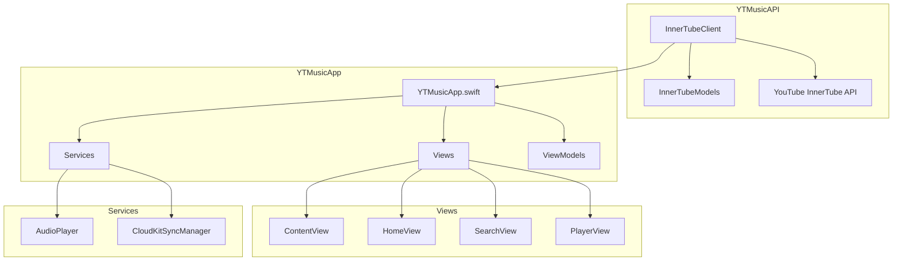
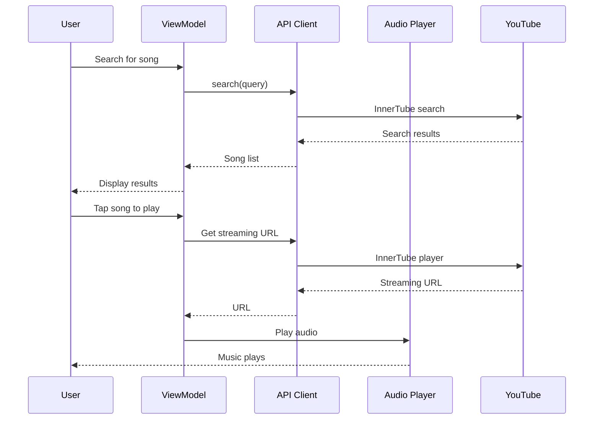
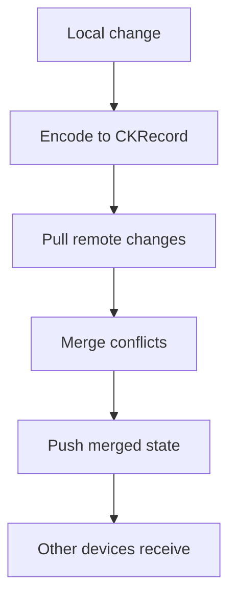

# landonkea-ytmusic-ios — Design & Workflow

## High-Level Overview

## Playback Flow

## CloudKit Sync Flow

## File Relationships

| File | Purpose | Used By |
|------|---------|---------|
| `Sources/YTMusicAPI/InnerTubeClient.swift` | API client | Views |
| `Sources/YTMusicApp/YTMusicApp.swift` | App entry | iOS |
| `Sources/YTMusicApp/Services/AudioPlayer.swift` | Playback | Views |
| `Sources/YTMusicApp/Services/CloudKitSyncManager.swift` | iCloud sync | Models |
| `Sources/YTMusicApp/Views/` | UI components | App |
| `Tests/` | Unit tests | xcodebuild |

## draw.io

[Open in draw.io](https://app.diagrams.net/#RYTMusic%20architecture)
